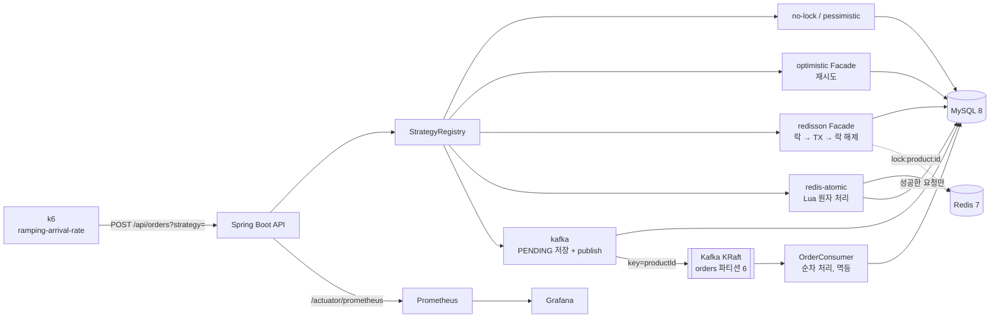

# stock-concurrency-lab

한정판 상품 선착순 구매라는 **하나의 요구사항**을 **여섯 가지 동시성 제어 전략**으로 구현하고, 정합성과 성능을 같은 조건에서 측정·비교하는 프로젝트.

> 한 줄 요약: 재고 N개에 요청 M건이 몰릴 때, 락 없음 / 비관적 락 / 낙관적 락 / 분산 락 / Redis 원자 연산 / Kafka 순차 처리가 정합성·처리량·지연에서 어떻게 다른지 코드와 테스트로 보여준다.

> **현재 상태**: 구현 완료. Docker(MySQL 8/Redis 7/Kafka) 위의 Testcontainers 통합 테스트 전부 통과, compose 스택 기동·API·Prometheus·Grafana 동작 확인, 시나리오 A~D(전략 5종)·한계 처리량·튜닝 변수를 실측하고 회차마다 정합성을 자동 검증했다. 자세한 내용은 [남은 작업](#남은-작업)과 [docs/decisions.md](docs/decisions.md).

## 1. 요구사항

- 재고 N개 상품에 동시 요청 M건 (예: 재고 100, 요청 10,000)
- 정합성 조건 (모든 전략이 만족해야 함)
  - 재고는 음수가 될 수 없다
  - 성공 주문 수 == 차감된 재고 수
  - 1인 1회 구매 (`UNIQUE(product_id, user_id)` 가 최후 방어선)
- 비교 지표: TPS, p50/p95/p99 latency, 에러율, 정합성, 자원 사용량

## 2. 문제 정의: no-lock 에서 재고가 깨진다

`findById → stock 감소 → save` 는 읽기와 쓰기 사이에 아무 보호가 없다. 두 요청이 같은 재고(예: 5)를 읽고 둘 다 4로 저장하면 주문은 2건 성공했는데 재고는 1만 줄어든다(Lost Update). 오래된 값을 읽은 요청이 이미 소진된 재고를 판매하는 초과 판매도 생긴다.

- `H2StrategyConsistencyTest.no_lock_은_Lost_Update_로_정합성이_깨진다` 가 재고 100, 사용자 1000명 동시 요청에서 **"성공 주문 수 ≠ 차감된 재고 수" 또는 초과 판매**가 발생함을 검증한다 (깨짐을 검증하는 테스트). 재현 확률을 높이려고 읽기-쓰기 사이에 5ms 지연을 넣는다 (D-07).
- 실제 부하(재고 100, k6 최대 1000 req/s, 3회): no-lock 은 **성공 주문 1,683~1,825건**이 만들어졌다(재고의 약 17~18배 초과 판매, 상품 1개 불일치). 자세한 표는 7장.

## 3. 아키텍처



패키지: `domain`(엔티티/리포지토리) · `strategy`(전략 + 트랜잭션 서비스) · `facade`(트랜잭션 바깥에서 재시도/락) · `api` · `consumer` · `config`.

## 4. 전략별 구현 요약과 함정

| 전략 | 요약 | 주의할 함정 |
|---|---|---|
| `no-lock` | 읽고 쓰기만 함 | Lost Update, 초과 판매. 베이스라인 |
| `pessimistic` | `SELECT … FOR UPDATE`, 락 대기 3000ms | 락을 기다리는 동안 **커넥션을 점유** → Hikari 풀 크기가 처리량/에러율을 좌우(풀 고갈). 풀 크기는 `HIKARI_POOL_SIZE` 로 분리 |
| `optimistic` | `@Version`, 충돌 시 재시도 | **재시도는 트랜잭션 바깥 Facade** 에서. 같은 TX 안 재시도는 오염된 영속성 컨텍스트를 재사용. 지수 백오프 + full jitter, 최대 횟수 설정값, 재시도 횟수 Counter. 핫 상품에서는 재시도 폭증 |
| `redisson` | `lock:product:{id}`, tryLock(wait, lease) | **락 획득 → TX 시작 → 커밋 → 락 해제** 순서. Facade 는 `@Transactional` 이 아니고 내부 서비스가 TX 를 가진다. leaseTime 만료 후 `unlock()` 은 예외 → `isHeldByCurrentThread()` 확인 |
| `redisson-wrong` | `@Transactional` 안에서 락 해제 | **커밋 전에 락이 풀려** 다음 요청이 옛 재고를 읽음 → 정합성 붕괴. 일부러 만든 버그 |
| `redis-atomic` | Lua 한 번으로 SADD→재고 확인→DECR, 성공한 요청만 DB 저장 | DB 저장 실패 시 보상(INCR+SREM)을 **TX 종료 후** 수행. Redis-DB 재고 불일치 위험, 기동/리셋 시 DB 기준 재적재 필요 |
| `kafka` | PENDING 저장(커밋) → publish(key=productId) → 202 | 커밋 **후에** publish. 같은 productId 는 같은 파티션 → 순차 처리라 락 불필요. Consumer 멱등(status≠PENDING 이면 skip). API 응답시간과 별도로 end-to-end 시간 Timer |

세부 결정과 이유는 [docs/decisions.md](docs/decisions.md) 참고 (Product/VersionedProduct 분리, HTTP 상태 코드 규약, publish ack 대기 등).

### API

- `POST /api/orders?strategy={name}` body `{productId, userId}` → 200(성공/품절), 202(kafka 접수), 409(중복), 503(락/재시도 한도 초과)
- `GET /api/orders/{id}` → 주문 상태 (kafka 전략의 최종 상태 조회)
- `POST /admin/reset?stock=100&products=1` → DB/Redis 초기화
- `/actuator/prometheus` → 메트릭

## 5. 실행 방법

사전 조건: JDK 21, Docker, k6 (벤치마크), jq (결과 집계).

```bash
# 인프라 + 모니터링 (MySQL, Redis, Kafka, App, Prometheus, Grafana)
./gradlew bootJar
docker compose -f docker/docker-compose.yml up -d --build
# Grafana: http://localhost:3000 (대시보드 "Stock Concurrency Lab"), Prometheus: http://localhost:9090

# 인프라만 띄우고 앱은 로컬 실행
docker compose -f docker/docker-compose.yml up -d mysql redis kafka
./gradlew bootRun
```

테스트:

```bash
./gradlew build          # Docker 없이도 H2/임베디드 Kafka 테스트가 실행된다
```

- Docker 가 있으면 `ContainerStrategyConsistencyTest`(MySQL + Redis + Kafka, 전 전략)가 함께 실행된다. 없으면 자동으로 건너뛴다(SKIPPED).
- Docker Desktop 29 에서는 Testcontainers 1.21.3 이 API 버전을 거부하므로 `~/.docker-java.properties` 에 `api.version=1.44` 가 필요하다 (D-09).
- Windows 에서 경로에 한글이 있으면 `GRADLE_USER_HOME`/`LAB_BUILD_DIR` 를 ASCII 경로로 지정해야 한다 ([트러블슈팅](#9-트러블슈팅-기록)).

벤치마크:

```bash
k6 run -e STRATEGY=pessimistic -e SCENARIO=hot k6/order.js          # 단건
scripts/run-benchmark.sh pessimistic,optimistic,redisson hot 3       # 워밍업 1분 + 3회, 원본 JSON 저장
scripts/aggregate-results.sh > docs/results/summary.md               # 중앙값 표
```

시나리오(`SCENARIO`): `hot`(단일 핫 상품) · `spread`(상품 100개 랜덤) · `ratio10` / `ratio100`(재고:요청 1:10 / 1:100) · `stages`(도착률 100 → 500 → 1000 rps). 모두 `ramping-arrival-rate`.

## 6. 측정 환경과 방법론

- 컨테이너 자원 고정 (`docker/docker-compose.yml`): MySQL 2 CPU/2GB, Redis 1 CPU/512MB, Kafka 2 CPU/1GB, App 2 CPU/1GB (JVM `-Xmx512m`).
- 공정성 규칙: 워밍업 1분(결과 폐기) → 회차마다 `/admin/reset` 으로 DB/Redis 초기화 → 각 3회 실행 후 **중앙값**.
- 에러율은 5xx 와 네트워크 오류만 센다. 품절(200), 중복(409), 접수(202)는 정상 응답.
- "VU 100 → 500 → 1000" 시나리오는 VU 수가 아니라 **도착률(req/s) 단계**로 구현했다 (arrival-rate executor 특성).
- 한계: k6 와 앱이 같은 호스트에서 돌면 서로 자원을 경쟁한다. 결과 해석 시 감안할 것.

## 7. 결과

### 시나리오 A: 단일 핫 상품 (재고 100, 도착률 최대 1000 req/s, 45초, 3회 중앙값)

`run-matrix.sh` 로 전략마다 앱을 재기동하고 워밍업 1분 후 3회, 회차마다 `/admin/verify` 로 정합성을 검증했다. 원본: `docs/results/raw/`, 집계: `docs/results/summary.md`.

| 전략 | 시나리오 | 회차 | TPS(req/s) | p50(ms) | p95(ms) | p99(ms) | 에러율(%) | 정합성 |
|---|---|---|---|---|---|---|---|---|
| kafka | hot @1000rps | 3 | 450.92 | 4.62 | 8284.04 | 30013.58 | 61.79 | 1/3 일치, 2 처리지연(pending 잔존) |
| no-lock | hot @1000rps | 3 | 374.98 | 2.32 | 30037.99 | 60000.27 | 95.00 | 0/3 일치, 3 불일치 |
| optimistic | hot @1000rps | 3 | 823.15 | 2.00 | 37.27 | 180.29 | 0.00 | 3/3 일치 |
| pessimistic | hot @1000rps | 3 | 811.68 | 1.77 | 225.91 | 681.75 | 0.00 | 3/3 일치 |
| redis-atomic | hot @1000rps | 3 | 825.55 | 1.03 | 4.15 | 26.11 | 0.00 | 3/3 일치 |
| redisson-wrong | hot @1000rps | 3 | 351.08 | 2.80 | 40324.45 | 58670.62 | 90.66 | 0/3 일치, 3 불일치 |
| redisson | hot @1000rps | 3 | 466.52 | 5.44 | 8640.59 | 30012.43 | 65.98 | 3/3 일치 |

**읽을 때 주의 (측정 한계)**
- 측정 환경: Windows 노트북의 Docker Desktop. **k6, 앱, MySQL, Redis, Kafka가 한 호스트에서 자원을 나눠 쓴다.** 앱 컨테이너는 2 CPU/1GB(JVM -Xmx512m). 절대값보다 전략 간 상대 비교로만 해석할 것.
- 도착률 램프 평균이 약 830 req/s 이므로, TPS 가 약 811~826 으로 같은 전략(pessimistic, optimistic, redis-atomic)은 제공된 부하를 모두 처리했다는 뜻이다. 한계 처리량은 아래 RATE 2000 측정을 볼 것.
- 에러율은 k6 `http_req_failed` 기준(5xx + 네트워크/타임아웃)이다. redisson 과 kafka 의 에러는 대부분 서버 5xx 가 아니라 **k6 클라이언트 30초 타임아웃**이다.
- **no-lock / redisson-wrong 은 정합성이 깨진다.** 재고 100 인데 no-lock 은 성공 주문 1,683~1,825건, redisson-wrong 은 1,468~1,899건이 만들어졌다(회차별 `verify`: 상품 1개 불일치). 즉 **재고의 15~19배를 초과 판매**했다. 에러율 90%+ 는 쓰레기 같은 상태에서 DB 가 포화된 결과이므로 성능 수치로 해석하지 않는다.
- 해석: pessimistic/optimistic/redis-atomic 은 에러 0%, redis-atomic p95 4ms 로 가장 낮다(품절 요청이 DB 를 건드리지 않음). redisson 은 단일 핫 상품에서 락 대기열이 쌓여 에러율 66%. kafka 는 모든 요청이 PENDING INSERT 를 DB 에 하고 Consumer 도 같은 DB 를 써서 포화되고 일부 회차는 180초 안에 PENDING 이 다 처리되지 않았다(성공 주문 수는 재고와 일치).

### 시나리오 B, C, D 및 한계 처리량·튜닝 (재측정)

앞선 실행은 환경 오염(이전 kafka 회차의 backlog, 스크립트 수정으로 인한 중단)으로 폐기하고, 전략이 바뀔 때마다 **앱 컨테이너를 재기동**하고 회차 전에 **Kafka consumer lag 0 을 기다리도록** 고쳐 다시 측정했다 (`scripts/run-matrix.sh`). 전략별 첫 시나리오에서만 워밍업 1분. 각 3회 중앙값, 회차마다 `/admin/verify` 로 정합성 자동 검증. 원본: `docs/results/raw/`, 집계: `docs/results/summary.md`. "hot" 행(@1000)은 위 시나리오 A 측정이고, "@2000rps"는 한계 처리량 측정, `[태그]`는 튜닝 변수다.

| 전략 | 시나리오 | 회차 | TPS(req/s) | p50(ms) | p95(ms) | p99(ms) | 에러율(%) | 정합성 |
|---|---|---|---|---|---|---|---|---|
| kafka | hot @2000rps [kconc6] | 3 | 534.69 | 5.48 | 10346.00 | 30021.50 | 79.16 | 3/3 일치 |
| kafka | hot @1000rps | 3 | 450.92 | 4.62 | 8284.04 | 30013.58 | 61.79 | 1/3 일치, 2 처리지연(pending 잔존) |
| kafka | hot @2000rps | 3 | 552.74 | 6.52 | 10582.07 | 30014.51 | 69.25 | 1/3 일치, 2 처리지연(pending 잔존) |
| kafka | ratio100 @1000rps | 3 | 395.86 | 3.73 | 10674.64 | 30012.22 | 64.72 | 2/3 일치, 1 처리지연(pending 잔존) |
| kafka | ratio10 @1000rps | 3 | 557.02 | 4.79 | 11839.85 | 30014.12 | 62.40 | 1/3 일치, 2 처리지연(pending 잔존) |
| kafka | spread @1000rps | 3 | 482.34 | 21.43 | 14993.64 | 30012.47 | 60.73 | 2/3 일치, 1 불일치 |
| kafka | stages @1000rps | 3 | 374.11 | 36.78 | 2758.04 | 30003.32 | 20.18 | 0/3 일치, 3 처리지연(pending 잔존) |
| no-lock | hot @1000rps | 3 | 374.98 | 2.32 | 30037.99 | 60000.27 | 95.00 | 0/3 일치, 3 불일치 |
| optimistic | hot @1000rps | 3 | 823.15 | 2.00 | 37.27 | 180.29 | 0.00 | 3/3 일치 |
| optimistic | hot @2000rps | 3 | 1661.90 | 1.61 | 7.38 | 31.31 | 0.00 | 3/3 일치 |
| optimistic | ratio100 @1000rps | 3 | 405.38 | 3.04 | 34275.45 | 37668.63 | 87.90 | 3/3 일치 |
| optimistic | ratio10 @1000rps | 3 | 449.14 | 2.04 | 30016.55 | 46766.01 | 93.07 | 3/3 일치 |
| optimistic | spread @1000rps | 3 | 727.49 | 4.83 | 6199.53 | 8487.41 | 33.43 | 3/3 일치 |
| optimistic | stages @1000rps | 3 | 491.32 | 1.09 | 2.30 | 3.99 | 0.00 | 3/3 일치 |
| pessimistic | hot @2000rps [hikari10] | 3 | 940.92 | 16.34 | 4846.45 | 10160.59 | 45.23 | 3/3 일치 |
| pessimistic | hot @2000rps [hikari50] | 3 | 1053.59 | 9.15 | 3772.14 | 7555.31 | 40.77 | 3/3 일치 |
| pessimistic | hot @1000rps | 3 | 811.68 | 1.77 | 225.91 | 681.75 | 0.00 | 3/3 일치 |
| pessimistic | hot @2000rps | 3 | 1282.68 | 8.50 | 2921.67 | 5164.23 | 33.86 | 3/3 일치 |
| pessimistic | ratio100 @1000rps | 3 | 418.48 | 4.84 | 16959.25 | 30013.03 | 56.38 | 3/3 일치 |
| pessimistic | ratio10 @1000rps | 3 | 457.21 | 1.05 | 30005.50 | 34381.19 | 91.10 | 3/3 일치 |
| pessimistic | spread @1000rps | 3 | 423.71 | 3.37 | 10744.85 | 30013.16 | 65.58 | 3/3 일치 |
| pessimistic | stages @1000rps | 3 | 490.45 | 1.13 | 2.42 | 4.58 | 0.00 | 3/3 일치 |
| redis-atomic | hot @1000rps | 3 | 825.55 | 1.03 | 4.15 | 26.11 | 0.00 | 3/3 일치 |
| redis-atomic | hot @2000rps | 3 | 1603.09 | 1.54 | 577.30 | 2432.92 | 0.00 | 3/3 일치 |
| redis-atomic | ratio100 @1000rps | 3 | 822.76 | 1.04 | 3.32 | 329.10 | 0.00 | 3/3 일치 |
| redis-atomic | ratio10 @1000rps | 3 | 409.36 | 2.16 | 30048.36 | 59997.74 | 93.96 | 3/3 일치 |
| redis-atomic | spread @1000rps | 3 | 465.16 | 11.68 | 17453.03 | 30003.02 | 68.26 | 3/3 일치 |
| redis-atomic | stages @1000rps | 3 | 491.30 | 0.57 | 1.32 | 2.53 | 0.00 | 3/3 일치 |
| redisson-wrong | hot @1000rps | 3 | 351.08 | 2.80 | 40324.45 | 58670.62 | 90.66 | 0/3 일치, 3 불일치 |
| redisson | hot @2000rps [wait10s] | 3 | 623.38 | 5.19 | 11051.05 | 13888.45 | 77.75 | 3/3 일치 |
| redisson | hot @1000rps | 3 | 466.52 | 5.44 | 8640.59 | 30012.43 | 65.98 | 3/3 일치 |
| redisson | hot @2000rps | 3 | 723.76 | 3.93 | 9545.64 | 11554.68 | 78.21 | 3/3 일치 |
| redisson | ratio100 @1000rps | 3 | 352.58 | 4.55 | 20383.03 | 27643.90 | 82.90 | 2/3 일치, 1 불일치 |
| redisson | ratio10 @1000rps | 3 | 456.96 | 2.02 | 26111.90 | 27180.89 | 92.94 | 3/3 일치 |
| redisson | spread @1000rps | 3 | 380.66 | 7.16 | 16481.43 | 30013.78 | 70.94 | 2/3 일치, 1 불일치 |
| redisson | stages @1000rps | 3 | 454.47 | 2.28 | 5328.44 | 6694.44 | 30.92 | 3/3 일치 |


**관찰 (이 환경 한정, 전략 간 상대 비교로만 읽을 것)**
- **정합성**: 재측정한 모든 회차에서 pessimistic, optimistic, redisson, redis-atomic 의 재고·성공 주문 수가 일치했다. kafka 는 성공 주문 수는 재고와 일치하지만 일부 회차에서 180초 안에 PENDING 이 다 처리되지 않았다("처리지연"). 이전 실행의 redisson/kafka 불일치는 재현되지 않았다.
- **분산 저경합(spread)**: redis-atomic 만 에러 0%(p95 25ms), 나머지는 12~34% 에러. DB 를 거치는 전략은 100개 상품 분산에도 Hikari/DB 에서 포화됐다.
- **재고:요청 1:100 (ratio100)**: pessimistic, optimistic, redis-atomic 은 에러 0%, redisson 55%, kafka 32%. 품절 응답이 대부분이면 DB 락을 안 잡는 경로가 유리하다.
- **재고:요청 1:10 (ratio10)**: 모든 전략이 TPS 450~490, 에러 88~92%(kafka 33%)로 비슷하게 무너졌다. 전략 차이가 아니라 **성공 주문 3,750건의 DB 쓰기가 한 상품 행에 몰리는 병목**으로 보인다 (kafka 는 접수는 하지만 PENDING backlog 로 이어짐).
- **부하 단계(stages 100→500→1000)**: pessimistic, optimistic, redis-atomic 에러 0%, redisson 31%, kafka 20%.
- **한계 처리량(hot @2000rps)**: optimistic 1,662 TPS(에러 0%), redis-atomic 1,603(0%), pessimistic 1,283(34%), redisson 724(78%), kafka 553(69%). optimistic 이 좋은 것은 재고 100 이 소진된 뒤 요청이 읽기 전용(품절)이라 충돌이 사라지기 때문으로 보인다.
- **튜닝 (hot @2000rps)**
  - Hikari 풀 10 / 20(기본) / 50: 941(45%) / 1,283(34%) / 1,054(41%). 풀 크기에 대해 단조롭지 않아 **회차 간 노이즈(한 호스트에서 k6·DB·앱 경쟁) 범위로 보이며 결론을 내지 않는다.**
  - redisson waitTime 3s → 10s: 에러 78% → 78%, TPS 724 → 623. 효과 없음(락 대기열 자체가 병목).
  - kafka consumer 동시성 3 → 6: 에러 69% → 79%. 개선 없음(병목이 Consumer 가 아니라 DB 로 보임).
- **redisson 락 만료**: 측정 중 `stock_redisson_lease_expired_total` 이 1회 증가했다(Prometheus 기록). 락 leaseTime 이 트랜잭션 종료 전에 만료될 수 있음을 확인했으나, 이번 측정에서는 불일치로 이어지지 않았다. 앞선 오염 실행의 불일치 원인이 이것이라는 확증은 아직 없다.

**측정 한계**: 한 노트북의 Docker Desktop 에서 k6, 앱(2 CPU), MySQL, Redis, Kafka 가 자원을 나눠 쓴다. 에러율은 k6 클라이언트 30초 타임아웃을 포함한다.

## 8. 결론: 상황별 전략 선택 (설계 기준 가이드)

> 구조적 특성에 시나리오 A 실측(7장)을 반영한 가이드다. 다른 시나리오는 아직 측정 전이다.

- **경합이 낮고 단순함이 중요** → `optimistic` (재시도 비용이 낮을 때). 핫 상품에는 부적합할 수 있다.
- **DB 하나로 충분하고 정합성이 최우선** → `pessimistic`. 단, Hikari 풀 크기와 락 타임아웃을 함께 튜닝해야 한다.
- **여러 앱 인스턴스가 있고 DB 락을 피하고 싶을 때** → `redisson`. 락/TX 순서를 반드시 지킬 것.
- **초고경합 선착순(대부분이 품절 응답)** → `redis-atomic`. DB 는 성공 건만 받는다. Redis-DB 불일치 대비 필요.
- **즉시 응답보다 확정이 늦어도 되는 경우, 부하 평탄화** → `kafka`. 응답과 확정이 분리되므로 e2e 지연을 별도로 본다.
- `no-lock`, `redisson-wrong` 은 쓰면 안 되는 예시다.

## 9. 트러블슈팅 기록

- **Windows 한글 경로에서 Gradle 테스트가 `ClassNotFoundException`**: 사용자 홈/프로젝트 경로에 한글이 있으면 테스트 워커가 클래스를 못 찾는다. `GRADLE_USER_HOME=C:/gradle-home`, `LAB_BUILD_DIR=C:/gradle-build/stock-lab` 환경변수로 ASCII 경로를 쓰면 해결된다 (D-04).
- **no-lock 에서 `@Version` 이 있으면 Lost Update 가 안 보임**: 낙관적 락 예외가 먼저 난다. 같은 테이블을 `@Version` 없는 엔티티로도 매핑해 분리했다 (D-02).
- **Bash 히어독**: 일부 환경에서 한글이 섞인 히어독이 깨져 파일 생성 도구를 사용했다. (프로젝트 코드와 무관한 작업 환경 이슈)

## 남은 작업

구현한 것: 1~6단계 전체 (도메인, 전략 7종, Facade, API/관리 API, Kafka Consumer, 메트릭, compose, Prometheus/Grafana, k6, 벤치마크 스크립트, 문서).

**검증한 것** (redisson 락 만료 재현 테스트 포함): `./gradlew build` (H2/임베디드 Kafka 테스트 + Docker 기반 Testcontainers 28개 전부 통과, 건너뜀 0), `docker compose up` 전체 스택, 7개 전략 API 호출, Prometheus 타깃 up, Grafana 대시보드, k6 시나리오 A 실측.

**남은 것**
- 호스트 자원 경쟁을 줄이기 위해 k6 를 다른 머신에서 실행 (이 환경에서는 불가).
- 튜닝 변수(Hikari 풀 등)는 회차 간 노이즈가 커서 회차 수를 늘려 다시 확인.
- 실제 운영 규모 비교를 위한 더 큰 인프라/다중 앱 인스턴스 측정.
