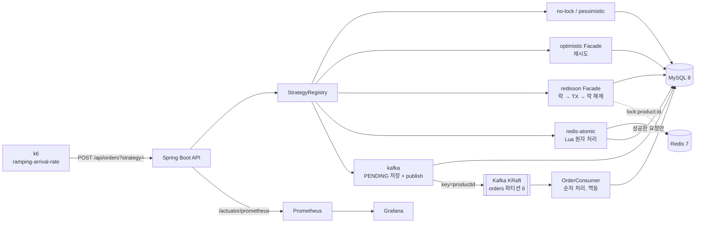
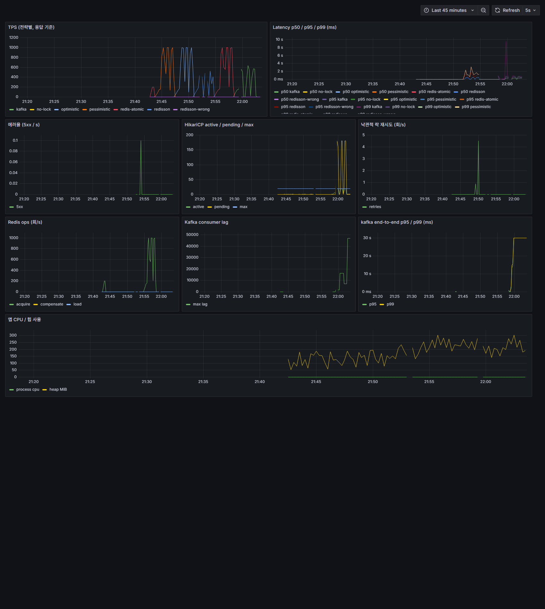

# stock-concurrency-lab

한정판 상품 선착순 구매라는 **하나의 요구사항**을 **여섯 가지 동시성 제어 전략**으로 구현하고, 정합성과 성능을 같은 조건에서 측정·비교하는 프로젝트.

> 한 줄 요약: 재고 N개에 요청 M건이 몰릴 때, 락 없음 / 비관적 락 / 낙관적 락 / 분산 락 / Redis 원자 연산 / Kafka 순차 처리가 정합성·처리량·지연에서 어떻게 다른지 코드와 테스트로 보여준다.

> **현재 상태**: 구현 완료. Docker(MySQL 8/Redis 7/Kafka) 위의 Testcontainers 통합 테스트 28개 전부 통과, compose 스택 기동·API·Prometheus·Grafana 동작 확인, 시나리오 A(단일 핫 상품)를 5개 전략으로 실측했다. 시나리오 B~D, no-lock/redisson-wrong 부하 측정은 아직 하지 않았다. 자세한 내용은 [남은 작업](#남은-작업)과 [docs/decisions.md](docs/decisions.md).

## 1. 요구사항

- 재고 N개 상품에 동시 요청 M건 (예: 재고 100, 요청 10,000)
- 정합성 조건 (모든 전략이 만족해야 함)
  - 재고는 음수가 될 수 없다
  - 성공 주문 수 == 차감된 재고 수
  - 1인 1회 구매 (`UNIQUE(product_id, user_id)` 가 최후 방어선)
- 비교 지표: TPS, p50/p95/p99 latency, 에러율, 정합성, 자원 사용량

## 2. 문제 정의: no-lock 에서 재고가 깨진다

`findById → stock 감소 → save` 는 읽기와 쓰기 사이에 아무 보호가 없다. 두 요청이 같은 재고(예: 5)를 읽고 둘 다 4로 저장하면 주문은 2건 성공했는데 재고는 1만 줄어든다(Lost Update). 오래된 값을 읽은 요청이 이미 소진된 재고를 판매하는 초과 판매도 생긴다.

- `H2StrategyConsistencyTest.no_lock_은_Lost_Update_로_정합성이_깨진다` 가 재고 100, 사용자 1000명 동시 요청에서 **"성공 주문 수 ≠ 차감된 재고 수" 또는 초과 판매**가 발생함을 검증한다 (깨짐을 검증하는 테스트). 재현 확률을 높이려고 읽기-쓰기 사이에 5ms 지연을 넣는다 (D-07).
- 재현 수치(재고 몇 개가 어긋났는지)는 실행마다 달라 README에 고정값으로 적지 않았다. 필요하면 테스트의 실패 메시지 포맷(`재고=%d, 성공 주문=%d`)을 출력해 확인할 수 있다.

## 3. 아키텍처



패키지: `domain`(엔티티/리포지토리) · `strategy`(전략 + 트랜잭션 서비스) · `facade`(트랜잭션 바깥에서 재시도/락) · `api` · `consumer` · `config`.

## 4. 전략별 구현 요약과 함정

| 전략 | 요약 | 주의할 함정 |
|---|---|---|
| `no-lock` | 읽고 쓰기만 함 | Lost Update, 초과 판매. 베이스라인 |
| `pessimistic` | `SELECT … FOR UPDATE`, 락 대기 3000ms | 락을 기다리는 동안 **커넥션을 점유** → Hikari 풀 크기가 처리량/에러율을 좌우(풀 고갈). 풀 크기는 `HIKARI_POOL_SIZE` 로 분리 |
| `optimistic` | `@Version`, 충돌 시 재시도 | **재시도는 트랜잭션 바깥 Facade** 에서. 같은 TX 안 재시도는 오염된 영속성 컨텍스트를 재사용. 지수 백오프 + full jitter, 최대 횟수 설정값, 재시도 횟수 Counter. 핫 상품에서는 재시도 폭증 |
| `redisson` | `lock:product:{id}`, tryLock(wait, lease) | **락 획득 → TX 시작 → 커밋 → 락 해제** 순서. Facade 는 `@Transactional` 이 아니고 내부 서비스가 TX 를 가진다. leaseTime 만료 후 `unlock()` 은 예외 → `isHeldByCurrentThread()` 확인 |
| `redisson-wrong` | `@Transactional` 안에서 락 해제 | **커밋 전에 락이 풀려** 다음 요청이 옛 재고를 읽음 → 정합성 붕괴. 일부러 만든 버그 |
| `redis-atomic` | Lua 한 번으로 SADD→재고 확인→DECR, 성공한 요청만 DB 저장 | DB 저장 실패 시 보상(INCR+SREM)을 **TX 종료 후** 수행. Redis-DB 재고 불일치 위험, 기동/리셋 시 DB 기준 재적재 필요 |
| `kafka` | PENDING 저장(커밋) → publish(key=productId) → 202 | 커밋 **후에** publish. 같은 productId 는 같은 파티션 → 순차 처리라 락 불필요. Consumer 멱등(status≠PENDING 이면 skip). API 응답시간과 별도로 end-to-end 시간 Timer |

세부 결정과 이유는 [docs/decisions.md](docs/decisions.md) 참고 (Product/VersionedProduct 분리, HTTP 상태 코드 규약, publish ack 대기 등).

### API

- `POST /api/orders?strategy={name}` body `{productId, userId}` → 200(성공/품절), 202(kafka 접수), 409(중복), 503(락/재시도 한도 초과)
- `GET /api/orders/{id}` → 주문 상태 (kafka 전략의 최종 상태 조회)
- `POST /admin/reset?stock=100&products=1` → DB/Redis 초기화
- `/actuator/prometheus` → 메트릭

## 5. 실행 방법

사전 조건: JDK 21, Docker, k6 (벤치마크), jq (결과 집계).

```bash
# 인프라 + 모니터링 (MySQL, Redis, Kafka, App, Prometheus, Grafana)
./gradlew bootJar
docker compose -f docker/docker-compose.yml up -d --build
# Grafana: http://localhost:3000 (대시보드 "Stock Concurrency Lab"), Prometheus: http://localhost:9090

# 인프라만 띄우고 앱은 로컬 실행
docker compose -f docker/docker-compose.yml up -d mysql redis kafka
./gradlew bootRun
```

테스트:

```bash
./gradlew build          # Docker 없이도 H2/임베디드 Kafka 테스트가 실행된다
```

- Docker 가 있으면 `ContainerStrategyConsistencyTest`(MySQL + Redis + Kafka, 전 전략)가 함께 실행된다. 없으면 자동으로 건너뛴다(SKIPPED).
- Docker Desktop 29 에서는 Testcontainers 1.21.3 이 API 버전을 거부하므로 `~/.docker-java.properties` 에 `api.version=1.44` 가 필요하다 (D-09).
- Windows 에서 경로에 한글이 있으면 `GRADLE_USER_HOME`/`LAB_BUILD_DIR` 를 ASCII 경로로 지정해야 한다 ([트러블슈팅](#9-트러블슈팅-기록)).

벤치마크:

```bash
k6 run -e STRATEGY=pessimistic -e SCENARIO=hot k6/order.js          # 단건
scripts/run-benchmark.sh pessimistic,optimistic,redisson hot 3       # 워밍업 1분 + 3회, 원본 JSON 저장
scripts/aggregate-results.sh > docs/results/summary.md               # 중앙값 표
```

시나리오(`SCENARIO`): `hot`(단일 핫 상품) · `spread`(상품 100개 랜덤) · `ratio10` / `ratio100`(재고:요청 1:10 / 1:100) · `stages`(도착률 100 → 500 → 1000 rps). 모두 `ramping-arrival-rate`.

## 6. 측정 환경과 방법론

- 컨테이너 자원 고정 (`docker/docker-compose.yml`): MySQL 2 CPU/2GB, Redis 1 CPU/512MB, Kafka 2 CPU/1GB, App 2 CPU/1GB (JVM `-Xmx512m`).
- 공정성 규칙: 워밍업 1분(결과 폐기) → 회차마다 `/admin/reset` 으로 DB/Redis 초기화 → 각 3회 실행 후 **중앙값**.
- 에러율은 5xx 와 네트워크 오류만 센다. 품절(200), 중복(409), 접수(202)는 정상 응답.
- "VU 100 → 500 → 1000" 시나리오는 VU 수가 아니라 **도착률(req/s) 단계**로 구현했다 (arrival-rate executor 특성).
- 한계: k6 와 앱이 같은 호스트에서 돌면 서로 자원을 경쟁한다. 결과 해석 시 감안할 것.

## 7. 결과

### 시나리오 A: 단일 핫 상품 (재고 100, 도착률 최대 1000 req/s, 45초, 3회 중앙값)

원본 JSON: `docs/results/raw/`, 집계: `docs/results/summary.md`, 실행 로그: `docs/results/benchmark-run.log`.

| 전략 | 시나리오 | 회차 | TPS(req/s) | p50(ms) | p95(ms) | p99(ms) | 에러율(%) |
|---|---|---|---|---|---|---|---|
| kafka | hot | 3 | 645.44 | 754.06 | 4038.94 | 5687.32 | 29.87 |
| optimistic | hot | 3 | 831.87 | 1.06 | 2.05 | 3.67 | 0.00 |
| pessimistic | hot | 3 | 831.54 | 1.13 | 2.14 | 9.44 | 0.00 |
| redis-atomic | hot | 3 | 831.88 | 0.53 | 1.16 | 2.62 | 0.00 |
| redisson | hot | 3 | 638.15 | 2.73 | 7399.01 | 9242.91 | 52.84 |



**읽을 때 주의 (측정 한계)**
- 측정 환경: Windows 노트북의 Docker Desktop. **k6, 앱, MySQL, Redis, Kafka가 한 호스트에서 자원을 나눠 쓴다.** 앱 컨테이너는 2 CPU/1GB(JVM -Xmx512m) 제한이다. 절대값보다 전략 간 상대 비교로만 해석할 것.
- 도착률 램프 평균이 약 830 req/s 이므로, TPS 가 약 831 로 같은 전략(pessimistic, optimistic, redis-atomic)은 **제공된 부하를 모두 처리했다**는 뜻이지 한계 처리량이 같다는 뜻이 아니다. 한계 처리량을 보려면 더 높은 RATE 가 필요하다.
- 에러율은 k6 `http_req_failed` 기준(5xx + 네트워크/타임아웃)이다. redisson 과 kafka 의 에러는 대부분 **서버 5xx 가 아니라 k6 클라이언트 30초 타임아웃**이다 (예: 한 회차에서 kafka 5xx 는 0건, 최대 응답시간 30초, VU 상한 2000 도달로 일부 iteration 이 dropped).
- 해석: pessimistic/optimistic/redis-atomic 은 이 부하에서 에러 0%. redis-atomic 의 p95 가 가장 낮다(품절 요청이 DB 를 건드리지 않음). **redisson 은** 단일 핫 상품에서 락 대기열이 쌓여 대기 한도(`wait-time-ms` 3s)·타임아웃으로 에러율이 높고 p95 가 수 초 단위다. **kafka 는** 모든 요청이 PENDING INSERT 를 DB 에 하고 Consumer 도 같은 DB 를 쓰므로 이 구성에서 포화되어 consumer lag 이 약 4.7만까지 쌓였고 end-to-end 시간이 30초 이상으로 늘었다 (대시보드 참고).
- 정합성은 부하 테스트가 아니라 Testcontainers 정합성 테스트(28개 통과)로 검증했다. 부하 실행 후 DB 최종 상태 검증은 하지 않았다.
- 시나리오 B~D(상품 100개 분산, 재고:요청 1:10/1:100, 부하 단계)와 no-lock/redisson-wrong 부하 측정은 **측정 예정**이다.

## 8. 결론: 상황별 전략 선택 (설계 기준 가이드)

> 구조적 특성에 시나리오 A 실측(7장)을 반영한 가이드다. 다른 시나리오는 아직 측정 전이다.

- **경합이 낮고 단순함이 중요** → `optimistic` (재시도 비용이 낮을 때). 핫 상품에는 부적합할 수 있다.
- **DB 하나로 충분하고 정합성이 최우선** → `pessimistic`. 단, Hikari 풀 크기와 락 타임아웃을 함께 튜닝해야 한다.
- **여러 앱 인스턴스가 있고 DB 락을 피하고 싶을 때** → `redisson`. 락/TX 순서를 반드시 지킬 것.
- **초고경합 선착순(대부분이 품절 응답)** → `redis-atomic`. DB 는 성공 건만 받는다. Redis-DB 불일치 대비 필요.
- **즉시 응답보다 확정이 늦어도 되는 경우, 부하 평탄화** → `kafka`. 응답과 확정이 분리되므로 e2e 지연을 별도로 본다.
- `no-lock`, `redisson-wrong` 은 쓰면 안 되는 예시다.

## 9. 트러블슈팅 기록

- **Windows 한글 경로에서 Gradle 테스트가 `ClassNotFoundException`**: 사용자 홈/프로젝트 경로에 한글이 있으면 테스트 워커가 클래스를 못 찾는다. `GRADLE_USER_HOME=C:/gradle-home`, `LAB_BUILD_DIR=C:/gradle-build/stock-lab` 환경변수로 ASCII 경로를 쓰면 해결된다 (D-04).
- **no-lock 에서 `@Version` 이 있으면 Lost Update 가 안 보임**: 낙관적 락 예외가 먼저 난다. 같은 테이블을 `@Version` 없는 엔티티로도 매핑해 분리했다 (D-02).
- **Bash 히어독**: 일부 환경에서 한글이 섞인 히어독이 깨져 파일 생성 도구를 사용했다. (프로젝트 코드와 무관한 작업 환경 이슈)

## 남은 작업

구현한 것: 1~6단계 전체 (도메인, 전략 7종, Facade, API/관리 API, Kafka Consumer, 메트릭, compose, Prometheus/Grafana, k6, 벤치마크 스크립트, 문서).

**검증한 것**: `./gradlew build` (H2/임베디드 Kafka 테스트 + Docker 기반 Testcontainers 28개 전부 통과, 건너뜀 0), `docker compose up` 전체 스택, 7개 전략 API 호출, Prometheus 타깃 up, Grafana 대시보드, k6 시나리오 A 실측.

**남은 것**
- 시나리오 B, C, D 실측 (`scripts/run-benchmark.sh <전략> spread|ratio10|ratio100|stages 3`).
- 부하 실행 후 DB/Redis 최종 정합성 자동 검증 (현재는 통합 테스트로만 검증).
- 호스트 자원 경쟁을 줄이기 위한 k6 분리 실행, 더 높은 RATE 로 한계 처리량 측정.
- redisson 의 `wait-time-ms`, Hikari 풀 크기, kafka consumer 동시성 튜닝에 따른 변화 측정.
